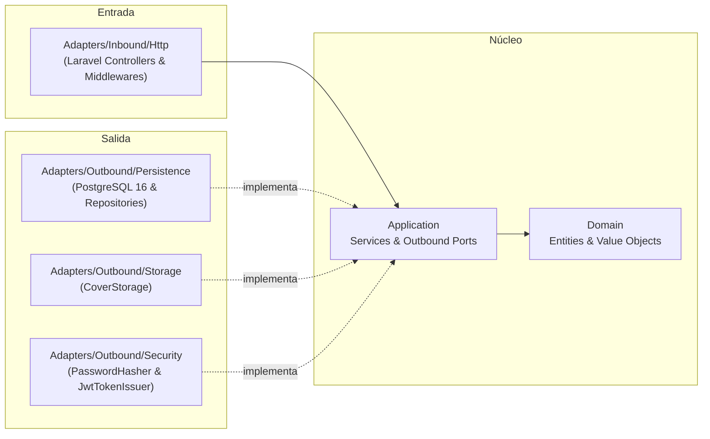

# Arquitectura Hexagonal — Manager Library (PHP / Laravel)

## 1. Capas y Principio de Inversión de Dependencias



## 2. Estructura de Directorios en `api/`

```text
api/
├── app/
│   ├── Domain/
│   │   ├── Model/ (Book, Loan, LoanItem, Member, User, Category)
│   │   ├── ValueObjects/ (Isbn, Quantity, DateRange)
│   │   └── Exceptions/ (Domain Exceptions)
│   ├── Application/
│   │   ├── Ports/
│   │   │   ├── BookRepositoryInterface.php
│   │   │   ├── LoanRepositoryInterface.php
│   │   │   ├── MemberRepositoryInterface.php
│   │   │   ├── UserRepositoryInterface.php
│   │   │   ├── ReportReaderInterface.php
│   │   │   ├── TokenIssuerInterface.php
│   │   │   ├── PasswordHasherInterface.php
│   │   │   └── CoverStorageInterface.php
│   │   └── Services/
│   │       ├── LoginService.php
│   │       ├── CreateLibrarianService.php
│   │       ├── BookService.php
│   │       ├── MemberService.php
│   │       ├── LendBooksService.php
│   │       ├── ReturnItemService.php
│   │       ├── OverdueLoansService.php
│   │       └── MostBorrowedReportService.php
│   └── Adapters/
│       ├── Inbound/Http/
│       │   ├── Controllers/
│       │   ├── Middleware/ (AuthMiddleware, RoleMiddleware)
│       │   └── Requests/
│       └── Outbound/
│           ├── Persistence/ (Eloquent/PDO Repositories)
│           ├── Security/ (JwtTokenIssuer, ArgonPasswordHasher)
│           └── Storage/ (LocalCoverStorage)
```
